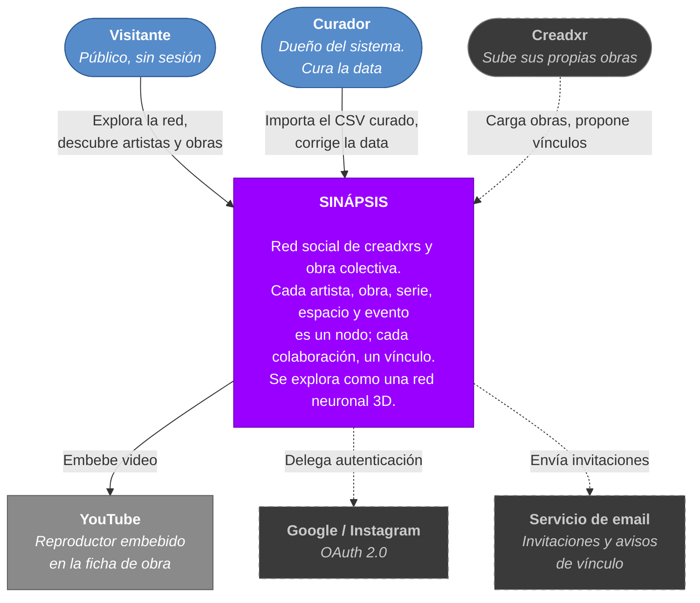
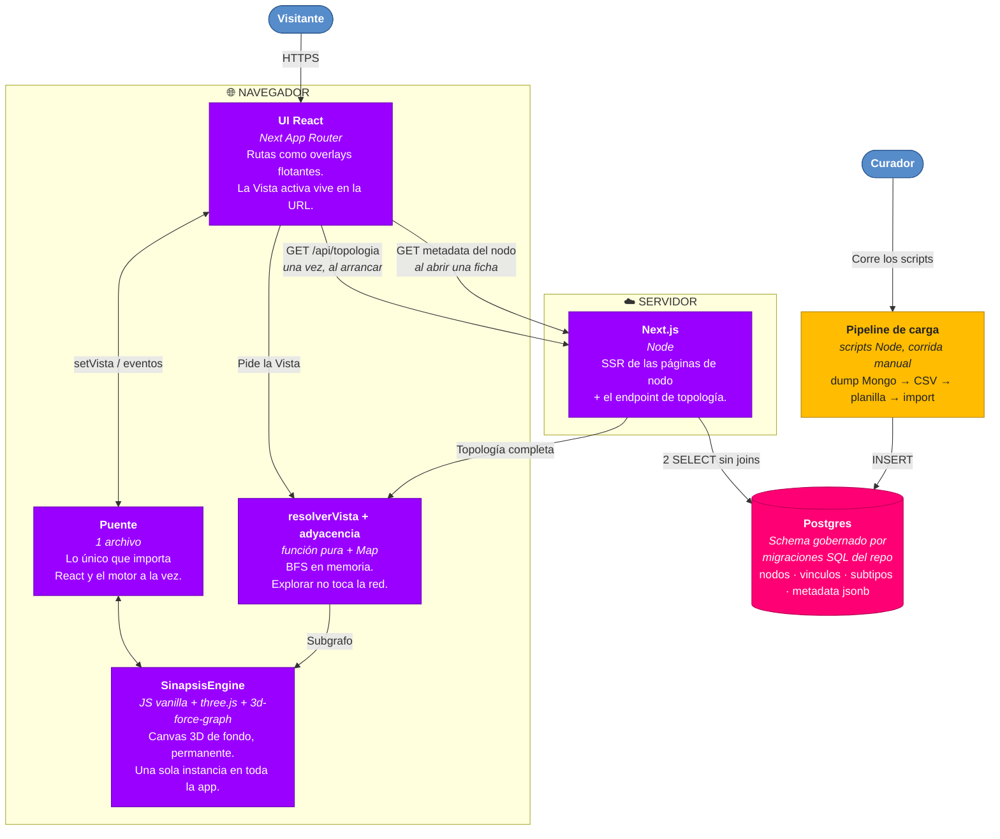
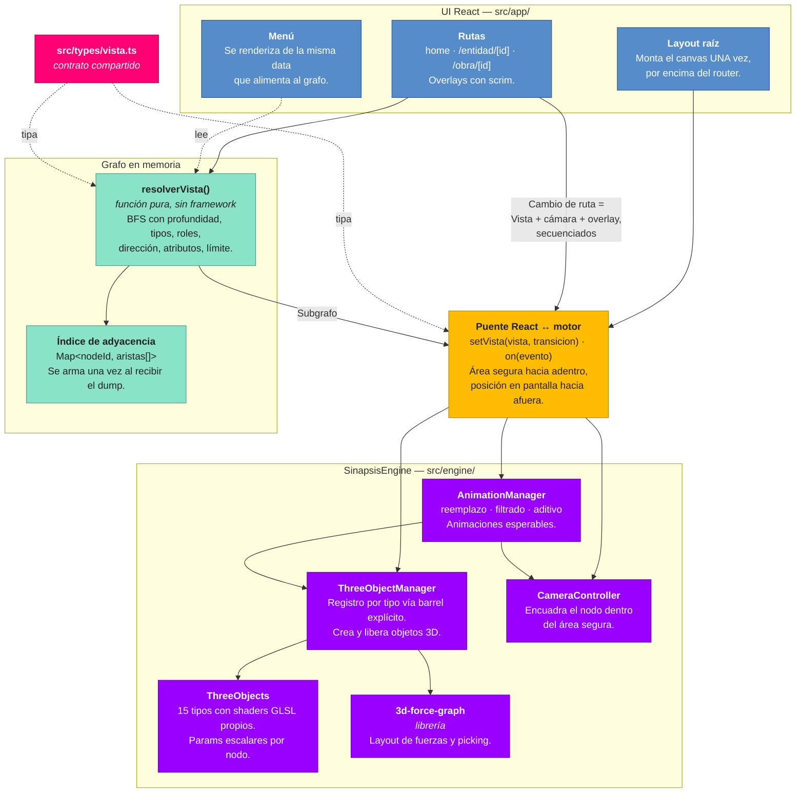
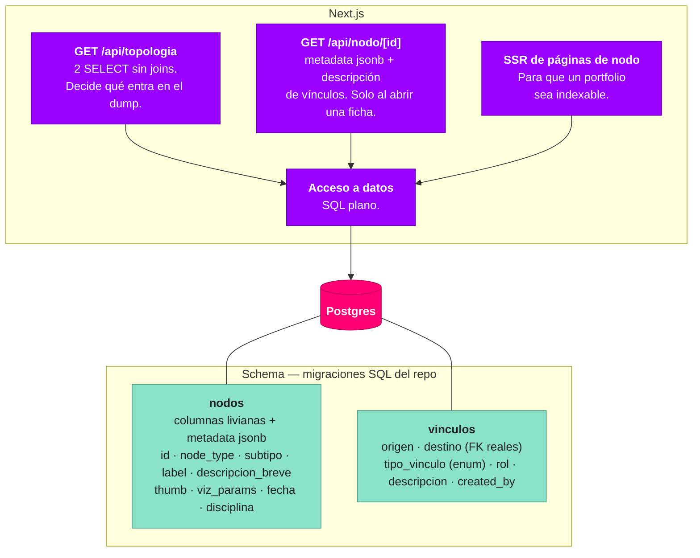
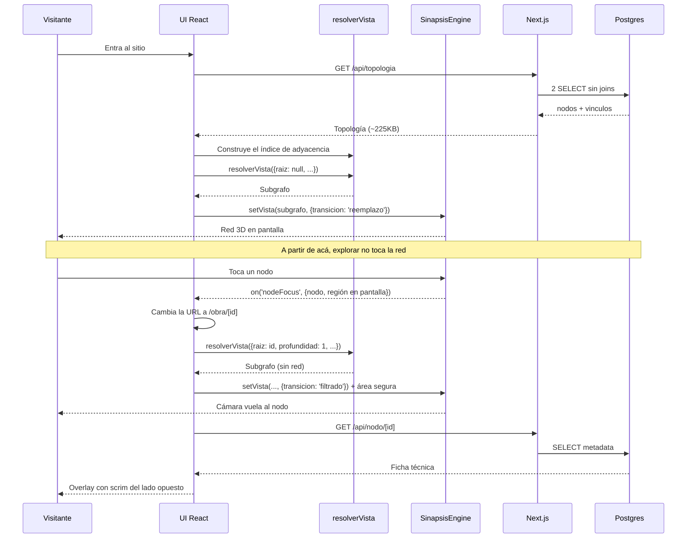

# Sinápsis — Arquitectura (C4)

> **Qué es este documento.** Los diagramas C4 del sistema: contexto, contenedores y componentes.
> Muestra **estructura**, no decisiones. El *por qué* de cada elección vive en
> [`.planning/PROJECT.md`](../.planning/PROJECT.md) (tabla de Key Decisions) y las reglas que no
> se pueden violar están en [`CLAUDE.md`](../CLAUDE.md). Si este documento y aquellos se
> contradicen, mandan aquellos.
>
> **Cómo verlo.** Es Mermaid: renderiza solo en GitHub, en Notion (pegando el bloque de código),
> en el preview de Markdown de VS Code y en cualquier visor de Mermaid. No hace falta instalar nada.
>
> **Convención:** línea sólida = existe o está planificado en el milestone 1.
> Línea punteada y borde gris = v2 o posterior, dibujado para que se vea hacia dónde crece.

---

## Nivel 1 — Contexto

Quién usa Sinápsis y con qué sistemas externos habla.

**Nota sobre tropicalponcho.art:** no es un sistema aparte. Es un dominio que apunta a la página
de perfil del nodo `ENTIDAD` Tropical Poncho. Que funcione sin código específico es la prueba de
que el modelo sirve para cualquier productora o centro cultural.

---

## Nivel 2 — Contenedores

Las piezas ejecutables y dónde vive cada responsabilidad.

### Por qué el reparto es este

| Responsabilidad | Dónde | Motivo |
|---|---|---|
| Recorrer el grafo | Navegador | La topología es idéntica para todos y a escala v1 son ~225KB. Explorar queda instantáneo, sin ida y vuelta por salto. |
| Guardar el grafo | Postgres | Constraints reales, `jsonb` anidado para la ficha técnica, y full-text y geo nativos para v2. |
| Decidir qué se publica | Servidor | En v2 los vínculos `PENDIENTE` no son públicos. Ese filtro nunca puede ser del cliente. |
| Renderizar | Navegador | Es el techo real del sistema: cada nodo es hoy un draw call. |

**Postgres nunca recorre el grafo.** Hace dos scans secuenciales para dumpear la topología y nada
más. El recorrido es un BFS sobre un `Map`. Por eso ninguna base de grafos aportaba: esa parte no
la hace una base.

---

## Nivel 3a — Componentes del navegador

El detalle de la pieza con más sustancia. `src/engine/` viene portado desde
`collectiveConscience`, donde ya corría en producción.

**La regla que sostiene este diagrama:** el motor no importa React y React no importa THREE. El
puente es el único archivo que ve a los dos. Ya se intentó al revés, con `react-force-graph-3d`,
en la rama `task/Refactor-en-React` de este repo, y falló.

---

## Nivel 3b — Componentes del servidor

Chico a propósito. El servidor casi no piensa.

### El tipado de vínculos, en tres niveles

Cada nivel vive en un lugar distinto según lo que pese:

1. **`tipo_vinculo`** — estructural, define cómo se recorre. Es lo que filtra la Vista. Va en el dump.
2. **`rol`** — semántico y filtrable: "director de arte", "dj"; y en `INSPIRO`, "cita directa" o "homenaje". Vocabulario distinto por tipo, mismo campo. Va en el dump.
3. **`descripcion`** — prosa para leer, no consultable. **No** va en el dump: se pide al abrir el vínculo.

---

## Flujo: qué pasa cuando alguien entra y toca un nodo

Lo importante del diagrama: **una sola llamada de red al arrancar**, y después una por ficha que
se abre. Recorrer la red —seguir vínculos, cambiar filtros, entrar y salir de sub-redes— no
dispara nada.

---

## Hacia dónde crece

| Cuándo | Qué cambia en estos diagramas |
|---|---|
| La topología deja de entrar en el navegador (~20-50k nodos) | `resolverVista` se muda al servidor. No se reescribe: es una función pura sin dependencias, por eso corre en los dos lados. El navegador pasa a pedir subgrafos en vez de la topología entera. |
| Auth (v2) | Entra un contenedor de sesión y el endpoint de topología empieza a filtrar por `estado` del vínculo. |
| Lxs creadxrs cargan sus obras (v2) | Entra una UI de carga en la app. Nunca un panel de CMS: el schema es del repo. |
| El render toca su techo (ver PERF-01) | `ThreeObjectManager` gana una segunda implementación con `InstancedMesh`. Los nodos cercanos siguen siendo meshes individuales; el resto va instanciado. Por eso `viz_params` guarda escalares y nunca GLSL. |

---

## Cómo mantener esto

Este archivo se actualiza cuando cambia la **estructura**, no cuando cambia una decisión. Si lo
que cambió fue el *por qué*, va en `.planning/PROJECT.md`. Si cambió una regla que no se puede
violar, va en `CLAUDE.md`.

Si algún día los cuatro niveles empiezan a contradecirse entre sí —el síntoma clásico de mantener
diagramas a mano— el paso siguiente es Structurizr DSL o LikeC4: se modela una vez y las vistas se
derivan. Hoy sería overkill, y un diagrama que necesita Docker para mirarse es un diagrama que no
se actualiza.

---

*Última actualización: 2026-08-06*
